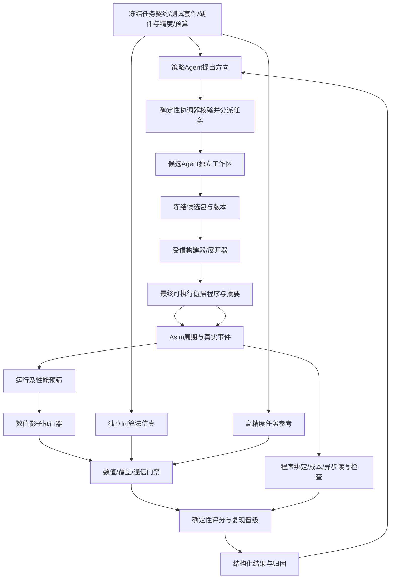

# 自动迭代框架实施计划：先建立可信数值执行边界

更新：2026-10-29（Asia/Hong_Kong）。计划基点：`29e56bb84695cfc51f44f3b4f5941db1dbd71400`。

状态：FW0–FW2初始Python库已开始实现，真实Asim同源程序适配尚未实现，不能整体验收。具体范围见 verification/contracts/README.md；不修改具体算子，不启动搜索。

负责人本轮调整：先建设“协调器生成策略 → Agent按方向生成候选 → Asim → 重建验证 → 打分反馈”的通用框架。第一批以独立合成小程序验收基础设施，真实NS等算子迁移排在框架验收之后。[验证体系](VERIFICATION_DESIGN.md)的G0–G6及三条数值路径继续有效；[NS实施包](audits/NS_SHADOW_EXECUTION_PLAN.md)保留为后续真实接入说明，不再是当前必须修改NS的前置任务。

## 1. 一致性约束的目标

约束的是：任务、原语语义、硬件能力、精度、计时范围、验证门禁和证据来源。不同算法的指令种类和数量可以明显不同；减少真实工作量是允许的算法收益。不能用“GEMM数量与基线接近”代替正确性，也不能为让排名整齐强制所有算法执行同样多的指令。

核心不变量：

1. 候选的最终输出来自实际低层程序对固定输入的执行，不能来自另一份公式或按算法名调用的标准实现。
2. 受信构建器从完整操作语义推导合法的数值操作及计时字段，候选不能单独填低成本计时字段。
3. Asim与数值执行器消费同一份最终低层程序；宏、融合和复数展开之后才冻结program hash。
4. 相同原语在不同算子中具有相同数值规则、资源约束和成本模型；不同分解/调度可产生不同实际成本。
5. 缺输入、缺语义、未知指令、缺事件、非有限数或未完成必需门禁，不得获得候选分数。

“同一个操作对象”只消除了两份声明脱节，不能证明builder或模型本身无误；其可信基础还需要独立原语样例、负例和交叉检查。

## 2. 框架与责任分界



数值与周期消费同一程序，但候选评估顺序固定为：静态完整性检查 → Asim可运行性/事件完整性与性能筛选 → 数值重建 → 其余门禁/复现/评分。运行失败、明显不具竞争力或加速异常的候选不进入数值执行，保持numeric_status=NOT_RUN、score=null；性能不能证明数值正确。原语开发单元测试不属于候选评估，仍可独立执行。

| 组件 | 有权做什么 | 无权做什么 |
|---|---|---|
| 策略Agent | 提出假设、搜索方向、候选预算建议，解释失败 | 更改冻结契约/阈值/硬件延迟、认定通过、签发分数 |
| 确定性协调器 | 按固定策略/预算检查任务，安排工作区、阶段、停止与归档 | 用模型自报PASS替代门禁；在失败后自动放宽门槛 |
| 候选Agent | 修改允许的候选程序、布局、调度和已授权算法参数 | 改builder/Asim/参考/测试/评分/硬件profile/产物；在宿主Python/C++偷偷算答案 |
| 审查Agent | 审核推导、发现遗漏和建议测试 | 代替执行证据或批准越界补丁 |
| 受信评估进程 | 冻结版本下重建、执行、检查、统计并出具结果 | 吞错换算法，随机补缺输入，以估算冒充实际成本 |

候选冻结后评估进程重新构建，覆盖Agent自带的二进制和结果；输出目录仅由评估进程写入。worktree只是版本隔离，正式接入可写候选时需要独立用户/容器的只读可信挂载与访问限制；不能仅靠prompt承诺“不改测试”。

## 3. 先冻结五份共同契约

| 契约 | 需要冻结的内容 | 防止的差异 |
|---|---|---|
| TaskContract | 输入/输出、shape、batch/Nrhs、复数布局、适用域、λ/信道/星座归一化、NaN/Inf行为 | 一个返回逆、另一个返回平方或中间量；不同信号模型混比 |
| AlgorithmSpec | 算法版本、递推式、X0、K/L/B、预条件器、恢复步骤、退出规则、合法等价变换 | 少迭代/换初值被当成纯调度优化；同算法参考偷偷多跑几轮 |
| ExecutionProfile | 原语与view、乘/累加/存储dtype、舍入/溢出、复数展开、融合能力、内存容量和单元吞吐 | 一方免费用complex128/高层求逆，另一方展开标量；单条SCALAR装下任意工作量 |
| EvaluationPolicy | 测试分组/拆分、门禁、误差与质量阈值、最小样本量、评分版本 | 为某候选放宽精度；只测batch0或少数有利信道 |
| MeasurementScope | given-A/b求解内核、H/y全流程、setup/apply、复用R、输入准备责任 | 漏计Gram、谱估计、初值、预条件构建、输出恢复和搬运 |

端到端共同目标为 `A=HᴴH+λI, b=Hᴴy, x_hat≈solve(A,b)`，独立高精度参考不选候选算法。求逆内核单独契约用solve(A,I)，不能与全流程周期混榜。输入只给契约声明的内容：未声明为输入的逆/分解/初值不允许由宿主免费提供。

内循环锁定AlgorithmSpec和精度，允许布局、调度、等价融合和复用；改变迭代数、初值、预条件器或精度转入外循环/参数变体并重新过门禁。不同算法可以有不同AlgorithmSpec，但必须在同一TaskContract、EvaluationPolicy与MeasurementScope下比较，使用同一个硬件能力/成本注册表。

新原语、新融合或新精度可以提出，但先走独立的基础设施升级与全基线回归；不允许候选提交自己的延迟函数或解释器绕过现有成本。

## 4. 单一低层程序怎样形成

最小路线是typed instruction schema＋受信builder/导出器＋解释器，不建设完整算法IR编译器。先用独立通用program harness连接Asim，保持现有 `src/inverse/`、legacy算子及旧Claude流程不变。

候选提交声明式低层程序或受限的builder调用。输入可含shape/静态参数，宿主只展开循环和分配资源；依赖矩阵数值的求解、归约、谱估计或条件分支必须表示为受支持操作。首版只支持静态程序，数据依赖分支/退出暂报UNSUPPORTED；以后加入真实分支与多输入事件绑定。原始C++任意代码在没有权限及语义限制时不作为可晋级候选接口。

拟议模块边界（均未实现）：

```text
automation/                 策略任务协议、受监督协调器、隔离runner、结果归档
verification/contracts/    五份契约与schema
verification/shadow/       内存、原语、顺序执行、精度profile
verification/reference/    独立同算法与任务oracle
verification/schedule/     实际事件、读写冒险与程序绑定检查
verification/quality/      固定通信suite、成对统计
verification/scoring/      硬门禁后评分，Agent不可写
verification/fixtures/     合成程序、已知解、变异与合法等价程序
src/semantic/              受信typed builder、派生计时/导出及通用Asim适配
```

具体源码路径在实施前按构建入口确认。核心记录包含唯一op/tile/core/buffer ID、有序src/dst、tensor/view/shape/stride/offset/mask、显式算术身份和常量、dtype/profile、overwrite/accumulate/zero_init、依赖/同步。最终展开对象的数值和计时投影来自同一spec；Asim消费的队列还要回报op_id/程序摘要，检查没有额外或遗漏的工作。

`compute_size`、tile维度、搬运请求数、分配size和单元选择由受信builder/profile从views推导并互相校验。候选只能选择注册过的实现/分块方案；不能填“数值算16×16、计时算1×1”。SUB与ADD可以共用注册的延迟映射，算术身份必须保留；同延迟不是同数值语义。

宏操作如CHOLESKY/INVERSE/TRSM可以用于说明或独立参考，正式候选必须展开为支持的低层操作再计时。高层np.linalg调用不能对应一条免费COMP。记录宏到实际操作的展开映射供诊断，但执行真值是最终低层程序。

## 5. 数值重建的四步交付

### 5.1 完整内存与操作语义

实现DRAM/SPAD/ACCUM，按空间、core、buffer、字节范围和view寻址；有初始化掩码、部分写入/有效区/边界、别名和写入版本。Tensor已分配或命中不等于有数值。LOAD/STORE真实复制数据，DMA请求地址和逻辑元素位置分开，不能用请求对齐覆盖缺失元素。

先支持LOAD/STORE、GEMM、ADD/SUB/MUL、COPY/FILL和同步；随后按覆盖需求加入DIV/SQRT、显式归约、标量及转换。尚未支持的指令使整次请求UNSUPPORTED，不按名称猜常量/共轭，不跳过Scalar/Vector，不随机补值。

单指令别名规则明确“完整读取后写回”的功能语义；跨指令错误覆盖必须在实际读写中出现。GEMM覆盖/累加、ACCUM初值、切片和尾块都有明确值。先用structure_f64确认结构，输出每个实际op的可追溯快照和最终STORE。

### 5.2 三条独立数值路径

| 路径 | 用途 | 独立性要求 |
|---|---|---|
| 实际程序重放 | 得到真正STORE输出及首个坏操作 | 只执行最终低层操作，不读FormulaLogger决定数学意义 |
| 同算法仿真 | 判断是否实现冻结算法，分离实现/收敛错误 | 同X0/K/参数与明示精度；不调用重放dispatcher或共享同一个错误高层原语 |
| 高精度任务oracle | 判断任务结果及近似质量 | 固定H/y/λ，独立solve；不按算法名更换oracle |

框架最初以矩阵乘、短迭代、带权重建等合成程序实现三路径的缩小版；没有相应算法参考时可做原语/任务检查，但不得将缺失的同算法检查标PASS。后续真实算法接入再补其AlgorithmSpec参考。

合法浮点重排可用冻结容差，融合/代数变换不要求内部节点同名。阶段可映射时比较阶段值；无法映射时比较共同语义边界、最终输出及独立性质。固定算法的严格实现一致性与不同算法的任务质量是两种检查，不能用后者掩盖内循环偷偷改变算法。

### 5.3 精度与复数

分别定义输入、乘法、累加、写回与存储类型，以及归约顺序、舍入、溢出/下溢。structure_f64只能得到结构结论；cast输入输出后用complex128计算，必须标为该近似模型，不能称为硬件FP16验证。

复数逻辑操作必须经过共同注册的实数展开并计入相关乘法/加减/转换/搬运；若Asim以后原生建模复数，则同样须有明确成本和独立校验。默认展开、三乘法等合法替代路线均可版本化支持，不能让某算法的一次复GEMM免费等同另一个算法的一次实GEMM。转置/共轭作为view只在硬件操作数访问确实支持时不额外搬运，否则显式materialize并计时。

精度profile通过表示的是“符合冻结数值模型”。真实硬件一致性还需实机校准，不把模型验收自动升级为实机结论。

### 5.4 真实异步事件

Asim提供每个实际op及DMA fragment的发射、读完成、写可见、完成及读写范围，和program一一关联。检查RAW/WAR/WAW、读未完成就覆盖、同步范围和buffer复用。缺事件无法认证；按start排序的顺序重放不代替G4。

重放覆盖与时序覆盖都按实际操作实例核对；完整事件集合包含明确允许的wait/metadata事件。所有有数值/资源作用的指令必须执行并计费；barrier/view等可按冻结模型作为同步/元数据处理，不能把“必须正周期”误用为每种元数据都强加成本。

## 6. 统一指令与成本，防止低报工作量

| 风险 | 框架硬约束 | 验收负例 |
|---|---|---|
| 少算或错算仍写漂亮公式 | 实际输出＋独立算法＋任务oracle；测试实际程序变异 | 漏GEMM/轮次/STORE、加减反向、输出平方 |
| 一条SCALAR代表任意长循环 | scalar固定标量语义；批量融合需注册为向量/归约或真实展开，成本随实际工作量推导 | compute_size=j但只付一次标量延迟，必须拒绝或展开 |
| 数值矩阵大、tile计时小 | builder从同view推导尺寸、工作量及请求数，拒绝矛盾字段 | 改tile/compute_size/size不能降价并保持原数学值 |
| 用高层求逆掩盖标量分解 | 高层节点全部降为低层；未知高层操作UNSUPPORTED | 添加一个INVERSE/COMP替代完整分解必须失败 |
| 预处理或宿主算术免费 | 只允许契约输入；所有数据依赖算术在程序中；预条件/初值/恢复计入范围 | 宿主提供Ainv或省去谱估计阶段不得参加全流程榜 |
| 复数/融合/精度口径不同 | 统一能力注册、展开及逐步dtype；更改profile须新版本/回归 | 免费共轭、隐式高精度、未注册融合必须失败 |
| 把分配当初始化 | 数值初始化掩码与显式FILL/COPY/LOAD | 跳初始化/读padding/部分覆盖后读全块 |
| 裁掉不利输入或尾块 | suite要求全部shape/batch/Nrhs/条件数组，按有效范围检查 | batch>1不同输入，15/17等尾块，不允许只验batch0 |
| 过拟合/硬编码答案 | 固定源码后评估，验证数据隔离、随机探针/变形检查、留出集限制 | 输入换种子/幅值/排列后仍需满足任务 |
| 改测评/伪造结果 | 路径白名单＋权限隔离，runner重建，受信结果只读 | 改scorer/config/trace或重用旧结果必须INVALID |
| 为利用率加无效GEMM | 只按过质量门禁的周期评分；输出依赖切片及冗余工作统计 | 插入无用矩阵乘不得因Cube升高获得奖励 |

指令数量异常只触发诊断，不直接判错。报告实/复乘加量、GEMM维度/次数、Scalar/Vector工作量、转换、实际搬运字节、padding、峰值内存、同步与阶段成本；所有统计从受信程序/事件计算。相同原语工作量随shape扩展的回归可发现成本不随规模增长的漏洞，但不能用统一FLOP下界否定合法算法变换。

性能比较必须包含硬件/精度模型版本与计时范围。迭代数减少带来的算法收益与调度重叠收益分别报告；输出质量满足统一约束才能参加同一任务的性能前沿。

## 7. 协调器任务协议与反馈

首版采用原生Agent＋受监督确定性runner，不依赖跨天控制器。规划产物至少包含：task_id、parent/baseline、direction、search_layer、hypothesis、allowed_paths、固定五契约hash、允许参数域、预算、停止条件、预期验证。direction可为data_reuse/layout/synchronization/pipeline/algorithm，不能只写“提高分数”。

协调器检查：内循环不得改AlgorithmSpec/精度；任务不得包含评估器写路径；候选基线必须满足该阶段要求；缺可支持原语的方向先建infra任务。不同Agent各自一个候选/工作区；有效对照与优化方向分开，不把不同质量配置交给Agent后直接比cycle。

每轮策略按以下顺序生成：

1. 从已验证前沿、失败分类和Asim瓶颈读证据。没有有效对照时先建立/复现对照，不引用旧UOBS默认周期填补基线。
2. 第一轮固定算法，将可辨别方向拆为数据复用/布局、合法同步/流水、注册原语实现选择等任务，先限制每个候选一个主要假设。算法/参数探索另开外循环任务，不能与该轮纯调度收益混算。
3. 协调器对方向去重、检查变更边界和预期原语支持，再分配有限候选/修复预算；每项包含对照、可测量预期和停止条件。计划或最终program hash重复时先检查完整缓存键，不重复当成新收益。
4. 比较同质量组的有效结果，将首次坏操作/内存hazard反馈到修复任务，将稳定的成本瓶颈反馈到下一方向。多候选同样失败时先检查共同基础设施，暂停相应方向，不能逼Agent用高层捷径绕过UNSUPPORTED。
5. 只有冻结版本的可复现收益才能更新前沿；预算耗尽保留当前有效对照和全部负结果。留出集只用于受控晋级，不让每轮策略无限查询。

首个runner阶段：`PROPOSED → GENERATED → FROZEN → BUILT → STATIC_CHECKED → SIMULATED → PERFORMANCE_SCREENED → STRUCTURE_CHECKED → NUMERIC_CHECKED → HAZARD_CHECKED → QUALITY_CHECKED → REPRODUCED → SCORED → ARCHIVED/PROMOTED`。这是拟议框架状态机，与旧脚本状态无自动兼容承诺。数值执行必须排在Asim通过与性能预筛之后；任何必需门禁缺失都不得评分。

反馈包含status、failed_gate、first_bad_op/view、预期/观察摘要、覆盖数、首个阶段偏差、残差/输出误差/通信分组、cost_breakdown、版本hash和建议修复类别。不把留出集全部输入或参考矩阵回传给候选；开发集可给细节，晋级集限制反馈，最终留出集控制使用次数。Agent自报测试、分数和解释只作附注。

独立评分器只读取受信结果；在同一比较组，全部必需门禁和复现通过、每个周期有限且>0后，使用冻结权重的几何平均周期加速比。失败、UNSUPPORTED、样本不足均score=null并保留原因。Cube/并行度不进奖励。

## 8. 按依赖实施与阶段验收

下列为粗略工程工作量，不是交付日期承诺；实际取决于依赖构建及精度范围。先完成支持范围再扩张，估时不包含大规模实验与实机校准。

| 包 | 预计 | 内容/允许范围 | 退出条件 |
|---|---|---|---|
| FW0 契约与防绕过规则 | 2–3工作日 | contracts、profiles、fixtures及独立oracle；不改算子 | 五契约schema、严格/任务比较规则、分组与成本范围冻结；缺项稳定拒绝 |
| FW1 同源低层程序与通用Asim入口 | 3–5工作日 | schema、typed builder、程序摘要、通用harness | 合成程序同对象驱动两backend；尺寸/成本不允许独立伪填；旧原语不猜测 |
| FW2 顺序影子执行 | 3–5工作日 | memory、最小算术/搬运、快照、独立三路径 | LOAD/STORE/别名/累加/尾块全覆盖；已知解与实际对象变异可定位；只标STRUCTURE_VERIFIED |
| FW3 精度/复数及共同原语注册 | 约1周起 | 乘累存profile、复数展开、Scalar/Vector/归约、转换 | profile符合性与规模成本回归通过；缺失硬件语义UNSUPPORTED，实机校准另记 |
| FW4 异步与成本闭合 | 3–5工作日 | Asim事件、读写冲突、DMA绑定、成本分解 | 删barrier/提前覆盖可捕获；完整程序/事件/输出一致；无免费高层或融合 |
| FW5 受监督协调器/隔离runner | 2–4工作日，可在FW1后并行准备 | task/result schema、白名单、worktree/build/TMPDIR、超时/重试/日志 | 先用回放/假worker测试分派与失败，不评分；评估权限隔离和产物篡改负例通过 |
| FW6 通信/评分/归档 | 3–5工作日，依赖FW2–FW5 | 统一suite、样本量、正周期/finite检查、版本绑定、干净复现 | 失败无分、分组均过阈值、复现后才评分；旧UOBS不参与签发 |
| FW7 框架验收 | 1–2工作日 | 合成程序及预定义合法调度变体，受监督完整闭环 | 1个有效对照＋至少3个方向变体完整运行；支持范围内所有变异拒绝；无效程序绝不晋级 |

实施优先级：FW0→FW1→FW2是第一开发批次，主要投入给数值重建；FW5可先准备协议和测试worker，但不能因为协调器能拉起Agent就宣布框架完成。FW3/FW4完成前不做性能晋级；FW6/FW7完成后再决定真实算子接入。框架阶段不修改 `src/inverse/`、legacy算子或旧Claude技能；通用Asim适配及Core事件修改属于单独基础设施变更。

首轮资源：生成Agent最多2、编译-j1与仿真串行。合成矩阵先N2/4/16、最多32个开发fixture，单项10秒；小sim120秒；configure600秒、build1200秒，磁盘/内存上限写入campaign。独立worktree/build/TMPDIR；确定性失败不重试，基础设施暂态最多重试1次，候选修复最多2次并生成新attempt。扩大样本或支持原语前先估算资源并冻结预算。

## 9. 必须同时有“拒绝错误”和“接受合法优化”的测试

变异至少包括：漏操作/轮次/STORE、SUB→ADD、漏共轭、错误初值/缩放/恢复、别名覆盖、缺初始化/事件、伪填尺寸/成本、免费高层求逆、SCALAR批量少计费、复数免费展开、改profile/评估器、伪造输出/缓存、损坏/缺输入/trace，以及NaN/零周期。

在支持范围内每个变异都有辨别输入、预期失败层和机器断言；保持公式日志不变也必须被捕获。未支持的变异标UNSUPPORTED，不混入“通过率”。原语测试覆盖转置/共轭、非均匀值、非方阵、尾块、不同batch、幅值和别名；不能只用I矩阵或已收敛初值，因为它们会掩盖漏算。

正例必须接受：合法tile变化、减少重复LOAD、等价融合、满足依赖的同步缩减、合法浮点重排和资源允许的流水重叠。只检查负例会导致框架拒绝一切优化，失去搜索意义。

门禁适用性由冻结EvaluationPolicy决定，不能让Agent把困难项自行改为NOT_APPLICABLE。原语微测试可以在契约中预先声明无通信输出，但不能因此声称完成MMSE通信验收。FW7至少包含一个从合成H/y/λ到x_hat的低维端到端程序，使用独立solve与冻结通信样本规则；样本不足时必须演示INCONCLUSIVE并拒绝评分。通用框架的通信门禁有真实通过/拒绝路径后，才算该模块验收，仍不代表真实六族算法已验证。

合成验收只证明已支持原语和框架闭环。真实算法的初值/收敛/通信适用域仍要单独接入并验收，不从合成fixture外推六族全部正确。有限测试也不是全输入形式证明；需要明确适用域、覆盖与留出策略。

## 10. 规划完成与框架完成分别如何判定

本轮规划完成：本文件、上位设计链接、DECISIONS和结构化依赖同步，资料校验通过并提交Git；尚无新执行能力。

框架v1完成：FW0–FW7有真实构建/运行/负例/正例/隔离/复现证据；能将实际低层程序的输出与独立参考比较，对漏洞给确定失败，并只为同契约下通过全部门禁的程序评分。随后真实NS迁移与算法修复另立任务，不把它混入框架基础设施提交。

## 11. 首批实现与Asim先行筛选（2026-10-29）

负责人调整：候选先Asim，再数值。初始实现提供Contract/ScreenPolicy、严格结构program builder、逻辑工作量统计、整块DRAM/SPAD/ACCUM实数FP64重放和瑞利参考生成器；21项单元测试通过。真实Asim适配、receipt来源认证、完整五契约与view/精度/事件仍待实施；FW0–FW2保持in_progress，不将测试receipt冒充真实仿真。

campaign冻结有效baseline_cycles、minimum_speedup与maximum_speedup；默认库参数仅为开发示例，不是校准过的性能阈值。已存在有效对照后，未达到最小收益的候选SKIPPED_NOT_COMPETITIVE；异常加速QUARANTINED_IMPLAUSIBLE_SPEEDUP；运行失败SKIPPED_ASIM_FAILED。均不执行数值、不评分。边界允许相等以便复现对照；新算法/新范围须重新建立匹配对照，无有效基线时不能随意套历史周期拒绝。必要时独立复核异常候选，以免永久丢弃真正突破。

第一批信道固定归一化瑞利：H实虚方差各1/(2Nr)，独立生成y、显式λ，oracle=solve(HᴴH+λI,Hᴴy)。它是任务数值样本而非已完成QAM/噪声/SER套件。后续新增CDL-B provider及独立版本/归一化/相关度配置；当前请求CDL-B明确UNSUPPORTED，不静默回退瑞利，也不把现有相关代理自动宣称完整标准模型。
