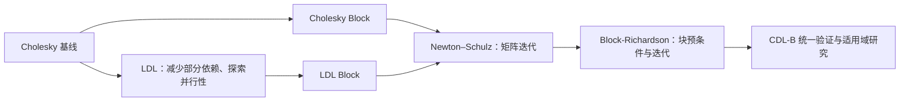

# 项目目标、研究路径与当前进展

版本：0.3；日期：2026-10-28。研究路线以项目负责人说明为准。本轮系统审计与证据边界见 [现状报告](STATUS_AUDIT.md)，各实现状态见 [状态卡](operators/INDEX.md)。

## 1. 研究问题

研究如何让 Agent 在可信闭环中自动发现和优化适合 NPU AI Core 的通信算子。矩阵求逆与 MIMO 均衡是当前载体，最终关注通信质量约束下的时延、吞吐和搜索效率。

不是单纯追求 GEMM 数量或 Cube 占用率。算法应减少串行依赖、提高有效矩阵运算占比、降低搬运与同步代价，并计入初始化、预条件构建和输出恢复成本。

闭环为：**均衡任务 → 调度控制器 → Agent 集群 → 候选程序 → Asim → 独立验证 → 评分 → 下一轮搜索**。其中均衡器是任务对象；控制器负责安排搜索与资源，二者单独命名。

## 2. 外循环：搜索算法结构

下面是研究演进关系，而不是声称后一算法在所有信道和规模下都优于前者。

1. **Cholesky 基线**：建立直接法与通信质量基准，识别标量平方根、除法及数据依赖。
2. **LDL**：由 Cholesky 出发探索依赖更少、并行潜力更大的分解；是否更快仍由实现和规模决定。
3. **分块化**：对两种分解分别得到 Cholesky-block、LDL-block，提高矩阵操作占比和 Cube 匹配程度。
4. **Newton–Schulz（NS）**：用矩阵迭代替代大量串行步骤，研究初值、迭代次数、精度与条件数的关系。
5. **Block-Richardson（BRI）**：沿条件数与预条件方向继续探索。根据负责人当前总结，它是已有研究中的性能最优候选；CDL-B 下必须重新验证。

该演进表示搜索思路，不把 NS 与 BRI 说成数学上同一种迭代，也不把分块名称当作必然的加速保证。

## 3. 内循环：固定算法后的实现优化

固定任务、算法语义及精度契约，搜索分块、布局、指令融合、数据复用、双缓冲、同步与流水重叠。迭代次数、初值和精度变化会影响数值行为，必须显式记录为参数或算法变体，不能伪装成纯调度优化。

NS 是历史内循环实验最详细的重点，优先整理其每轮假设、改动、周期、质量和失败原因。单独区分：算法变体收益、参数变化收益、指令调度收益，避免把三者混成一个加速比。

## 4. 当前成果与状态

| 内容 | 当前认识 | 证据等级／下一步 |
|---|---|---|
| Asim 周期模型 | 已有 Cube/Vector/Scalar、存储与互连模型 | 代码存在；未完成本次实机校准 |
| 6 基线＋Cholesky Merge | 源码位于 `src/inverse/`，注册表已有对应条目 | 七张状态卡已落地；存在输入/公式/指令/时序缺口，均未完整验证 |
| NS 内循环优化 | 历史研究较详细，包含初值、迭代和流水优化 | 17项历史谱系已整理；部分候选commit/输入/日志缺失，逐项保留null |
| BRI 最优候选 | 当前搜索结果中性能领先 | 负责人确认；仅在原试验范围内成立 |
| BRI 的 CDL-B 表现 | 旧报告有失败实验，本轮仍列为开放验证任务 | 不把有限配置失败推广为算法不可能 |
| Claude Code 自动迭代 | 已有 opt-round/eval-patch/op-flow 等流程 | 技能与脚本存在；部分路径与并行机制过时 |
| DAG 重放 | 已有 FormulaLogger 与 Python 重放 | 自一致性不能替代真实程序数值验证 |
| Codex 自动化 | 三子Agent完成独立审计与文档汇总；盘点/诊断/资料校验工具落地 | 受信数值执行器、runner与端到端验收仍未实现 |
| INT8 PCG、端到端链路 | 9 月材料中有成果或计划描述 | 当前仅记为历史材料声称，等待代码与数据定位 |

证据等级统一为：`owner_reported`（负责人陈述）、`documented`（历史记录）、`code_present`（代码可见）、`reproduced`（统一环境重跑）、`validated`（完整门禁通过）。同一成果可有多个标记，不能因为有源码就升级为 validated。

## 5. 历史时间线

| 时间 | 阶段 |
|---|---|
| 原开题 | Atlas 310B/Ascend C，复数基础算子、MIMO 检测与 OFDM 链路 |
| 2026-06 末 | 无分块基线统一与指令合并、复用、同步优化计划 |
| 2026-07 上旬 | 求逆目录重构、算子标准、DAG、审计与 CI |
| 2026-07-08 至 14 | SER 评估、数值实现修正、BRI 相关信道实验；最新既有提交为 5a86e9fc |
| 2026-09 | 中期计划扩展混合精度、预条件、LLM 反馈与完整链路 |
| 2026-10-28 | 当前优先级调整为历史整理、版本管理、可信验证及 Codex 平行闭环 |

9 月的年月安排不自动顺延为当前承诺。当前依赖关系与验收计划见 ROADMAP.md。

## 6. 历史数据使用规则

23,439、9,999、6,440、4,959、1,993 等周期在旧报告中出现；NS 还存在 N=32、K=8 的 2,591 周期和 K=16 的估算值。这里不把它们绘成同口径排行榜。

历史条目必须补齐矩阵形状、batch、信道、精度、迭代次数、测量范围、配置、commit、原始日志。缺少任一关键条件，就保留为历史观察，不参与新框架冠军选择。

研究成功的判据包括：相同质量约束下周期下降；未见输入上保持质量；在固定搜索预算下更快得到可行解；结果可以从 commit 和输入种子复现。Cube 有效利用率和流水重叠用于解释收益。
