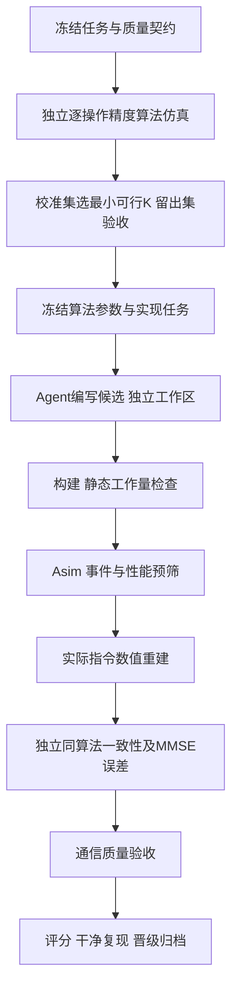

# 精度约束下的迭代算法与算子生成

版本：2026-11-08 / QW3c。来源：负责人关于按精度选 K、MMSE/SE 分工和先算法后算子的讨论。
本文是当前架构说明；固定历史版本与论文检索入口为 [paper_archive](paper_archive/README.md)。

## 目标与当前实现边界

最终目标是在冻结的通信质量要求下最小化完整任务周期：

\[
\min_{算法,K,精度,布局,调度} T_{H,Y\rightarrow\hat x}
\quad\text{s.t. 实现一致性、数值安全及通信质量通过。}
\]

已实现**离线算法选 K**和**受监督的计划冻结/执行交接**，复用 Asim 先行、真实指令重建、独立同算法参考和高精度任务参考。
已实现Q3a工程试验下瑞利/QPSK相对BER、原始软符号EVM与留出置信门禁；Q3b已有实际I/Q响应和高斯线性SE代理的有限样本诊断。Q3c已完成七新入口三SNR的未编码QPSK完整链路与独立复核，详见[验收报告](../../experiments/qpsk_full/2026-11-08-v1/README.md)。总体SE质量/BLER、CDL-B、无人值守协调器、评分及自动晋级仍未完成。
新工具不授予完整通信通过，也不修改算子、重建核心或固定 runtime。计划当前绑定已验收二进制，新的C++候选仍需独立构建和受信runtime发布。
NS K16、BRI K192 是此前重建链路的验证参数，不是统一质量约束下的最优配置。

## 阶段与约束

算法仿真发生在编写算子之前；**候选的数值重建仍在 Asim 通过之后**。
构建、指令工作量、Asim 或性能预筛失败时，候选重建为 NOT_RUN、score=null。
性能预筛使用相同任务/输入/精度/计时身份的冻结基线；没有基线时只建立基线，不宣称提升。
阶段间不得把 ALGORITHM_SCREENED、Asim 结束或重建匹配改写为完整通信 PASS。

| 阶段 | 输入与输出 | 退出条件 / 失败处理 |
|---|---|---|
| 质量契约 | 任务、场景、阈值、预算 → 冻结配置 | 未定义指标/不支持信道拒绝，不能随机代替 |
| 算法筛选（已实现受限版） | 独立 FP16 模型、K 网格 → 曲线和选定 K | 校准全样本过线；留出失败 HOLDOUT_FAILED，不用该集继续调参 |
| 实现冻结（已有受监督交接） | 重新核验筛选、参数/任务/源码/runtime摘要 → 批准计划 | K/初值/预条件/精度变更产生新计划；外部SHA-256不可随候选改写 |
| 构建/Asim（已有） | 独立 worktree/build、真实指令 → 周期/事件 | 指令或事件失败拒绝；异常快不能豁免正确性 |
| 重建（已有） | 实际指令、同一输入 → 实际数值与三路径误差 | 未知语义 UNSUPPORTED；实现不符与算法不达标分别归因 |
| 通信（Q3a受限版已实现） | 实际重建输出、配对符号/MMSE、全部留出H → BER/EVM与置信界 | 只签发声明范围内QPSK工程检查；SE必需时UNSUPPORTED，不用标准算法代替候选 |
| 评分/晋级（待实现） | 全门禁证据、周期、复现 → 前沿及归档 | 任何必需门禁未过 score=null；失败原样保留 |

## 如何选择迭代次数

1. 固定算法版本、初始化、预条件、松弛系数、精度与运算形式，之后才比较 K。
2. 所有 K 使用相同校准输入。遍历整数或显式网格，不假设 FP16 误差单调，不直接二分。
3. 当前实现要求每个场景、种子、batch 的 MMSE 输出相对误差均不超过冻结阈值。
   有缺口的网格只声明“网格内最小”；不能声称找到了所有整数中的最小值。
4. 最小校准可行 K 仅在独立留出集验收；不通过则本轮失败。新假设/新契约要使用新的留出集。
5. 设置最大 K、参考调用数和外部运行预算。数值平台期、溢出或预算内不可行均保留负结果。
6. 先固定每种任务适用域的 K。动态停止后置，需要可运行的残差判据，并计入判据、同步和最慢核成本。

不允许用每个样本的 MMSE oracle 决定在线 K，也不能把 batch96 每个样本的最优 K 平均后冒充24核周期。
最小 K 只是固定实现中的筛选规则；不同算法的初始化、预条件及每轮成本不同，最终仍比较完整周期。
未来可用小型安全余量/分位数和超限概率形成质量约束，但必须预先冻结统计定义和置信要求。

## 三种误差与通信指标

设实际重建为 r、独立同算法精度参考为 a、高精度 MMSE 为 m，分别记录：

- 实现误差：r 对 a。当前固定顺序 FP16 模型要求位一致；合法重排需有版本化精度契约与对应验收。
- 算法任务误差：a 对 m。判断 K、预条件或精度是否足够。
- 实际任务误差：r 对 m。判断交付算子的实际输出。

MMSE 参考使用同一原始高精度 H/Y；逐操作模型读取量化输入。因此任务误差包含输入量化、算法近似与运算误差。
筛选使用每个 batch 矩阵的 Frobenius 相对误差；二维向量/多 RHS 与其他范数不可混用。
2% 沿用已有工程阈值作为样例，**未证明对应某个 SE/BER 损失，不是最终通信规范**。
若 FP16 平台期已满足通信质量，不应仅为追求 FP64 的 1e-10 而继续增加 K。

正式通信验收建议固定相同 H、符号、噪声和 CSI 条件，报告配对的
ΔSE=SE_MMSE−SE_candidate，并按 SNR/形状/信道分组报告平均、尾部与超限比例。
有限统计样本必须给出数量及不确定性，不以一次均值过线代表整个适用域。
低 SNR 时相对 SE 损失分母很小，应优先明确绝对 bits/s/Hz 损失。

对于线性均衡器 W，速率代理使用滤波后的干扰和噪声：

\[
\mathrm{SINR}_i=\frac{|(WH)_{ii}|^2}{\sum_{j\ne i}|(WH)_{ij}|^2+\sigma^2(WW^H)_{ii}},
\qquad R_{proxy}=\sum_i\log_2(1+\mathrm{SINR}_i).
\]

该式假设单位符号能量、白噪声及线性接收器；不是带编码链路的实际吞吐量。
逐操作 FP16 舍入还会产生数据相关误差，系数代理不能覆盖所有符号级失真。
有限调制/编码场景使用明确的 BER、BLER 或 GMI/有效吞吐量补充；实际编码链路属于后续工作。
SE 对部分输出缩放不敏感，不能证明输出契约正确；MMSE 误差也不与 SE 一一对应。
不能只由 H 算信道容量来代表候选质量，也不能把速率裁到调制上限后用饱和值掩盖差异。
当前仅输出少量 xhat，不能据此精确推断 W。后续需要实际系数见证或独立探针协议；
额外探针工作量单独归档，不混入正常 RHS8 的周期比较。

相关指标区分参考：[Sionna PHY abstraction](https://nvlabs.github.io/sionna/sys/tutorials/notebooks/PHY_Abstraction.html)。
这是指标定义参考，不是本工程已集成 Sionna 的声明。

## Agent 防漏算与一致性约束

- 外循环允许改变 K/算法/精度，但必须生成新版本；内循环任务冻结这些项。
- 候选只能修改分配的源路径，不允许修改评估器、参考、质量阈值、任务输入、成本 profile 或日志签发器。
- 每项任务清单记录任务摘要、参数、精度、计时 scope、父候选、允许修改范围、预算和 evaluator/runtime 摘要。
- H/Y 到输出的 DMA、Gram、正则化、初始化、预条件、迭代和恢复都计时；复用必须有显式摊销范围。
- 不要求不同算法指令数量相同；要求完成相同任务，每条原语真实工作量与计费一致。旧 Merge 是应保留的负例。
- 独立 worktree/build/log；当前2 vCPU构建/仿真串行。基础设施失败按冻结预算有限重试；数值失败产生新候选，不能重跑到偶然通过。
- 同算法参考独立于实际重放核心，禁止按算法名调用标准解法代替真实指令执行。

## 可执行入口与后续依赖

现有入口及契约见 [planning/README](../../verification/planning/README.md)，
小规模命令与结果见 [本轮记录](../../experiments/quality_planning/2026-11-08-v1/README.md)。
它是架构烟测，不是替换既有 batch96 的性能或通信结论。

| 顺序 | 开发任务 | 验收标准 |
|---|---|---|
| Q1 已完成 | 冻结数值质量契约、独立参考选 K、留出拒绝 | 非单调/欠迭代/坏输出/留出失败/缺指标负例，以及真实 NS/BRI 烟测 |
| Q2 已完成受监督版 | 计划与已验收候选运行器的受信交接 | 171测试；NS/BRI真实Asim 8场景/192batch；改K/精度/输入/版本拒绝；真实性能预筛不通过数值NOT_RUN |
| Q3a 已完成受限版 | 真实输出的瑞利/QPSK BER/EVM与联合超限置信界 | 187测试；七入口历史只诊断；新NS batch96双噪声全部留出通过；必需SE拒绝 |
| Q3b 有限样本试点已实现 | 实际I/Q响应、复线性/预测/RHS检查、高斯线性SE代理 | 200测试；七新入口及NS留出共375次实际重放、独立参考位一致；未通过响应模型不输出代理 |
| Q3c 未编码瑞利版已完成 | 七新入口三SNR实际重放、BER/SER/EVM、独立判决 | 212测试、21组通过；CDL-B/K曲线见CHANNEL_DOMAINS；不要求编码 |
| Q4 | 前缀状态复用与预算执行 | 与当前独立模型各 K 逐位一致，测量时间/内存收益；不改变选择结果 |
| Q5 诊断已执行、验收未过 | 真CDL-B输入域/K曲线；后续修正候选和正式晋级 | 21组6通过/1数值失败/14拒绝；见CHANNEL_DOMAINS；score=null |

Q2证据见 [计划交接验收](../../experiments/quality_handoff/2026-11-08-v2/README.md)，入口见 [planning/README](../../verification/planning/README.md)。
Q3a/Q3b证据见 [通信验收](COMMUNICATION_VERIFICATION.md)及[响应代理协议](../../verification/communication/RESPONSE_PROBES.md)；下一优先级CDL-B与K/精度研究，编码不是求逆算子验证前置，Q4可独立推进。硬件级认证由负责人上板，继续作为外部研究证据。

## Q3c完整未编码QPSK及下一步

2026-11-08 Q3c当前：完成声明范围内未编码QPSK完整bit-to-bit链路。七新入口×Es/N0 0/10/20dB共21配置，14次新Asim、168帧、16,128次batch重放通过；212测试与独立4,128,768bit复核通过，全部同算法精度参考位一致，最大MMSE任务误差0.2744%。每组192独立H，全实验配对复用同192个H。该试验通过相对BER/SER/raw EVM门禁，不签发FEC/BLER、CDL-B、总体SE或最终晋级。见[验收报告](../../experiments/qpsk_full/2026-11-08-v1/README.md)及[可执行协议](../../verification/communication/QPSK_LINK.md)。

新增SER及有限四帧块门禁；置信统计单位为H，跨算法/SNR配对数据不扩充独立H。当前K沿用冻结正确性基线。下一阶段先冻结业务相对/绝对质量及采样预算，再用完整链路开展校准集选K、全新独立留出；扩大维度和CDL-B分版本执行，失败停止，不在留出失败后自行加K。

## 当前范围修订：编码后置

负责人确认本阶段以求逆/均衡精度为目标，编码不作为前置或必须补齐的门禁。优先执行真实CDL-B输入域和K/精度曲线，见[信道与精度协议](CHANNEL_DOMAINS.md)。既有历史段落中的BLER/FEC为可选未来任务，不影响声明范围的算子数值验收。

2026-11-08 CDL-B/K曲线更新：编码不是求逆/均衡精度的前置。新增真正Sionna CDL-B静态频域输入，21组中6组通过、BRI 1组数值失败、14组象限/溢出拒绝，整体未通过；独立复核7个完整组688,128bit。FP16/FP64的K—误差曲线已归档，显示NS精度平台及固定BRI的收敛问题；不能只加K。216测试通过，仅清理约3.02GB可再下载缓存，旧研究原件保留。见[报告与图](../../experiments/channel_validation/2026-11-08-v1/README.md)及[输入域/精度协议](CHANNEL_DOMAINS.md)。
