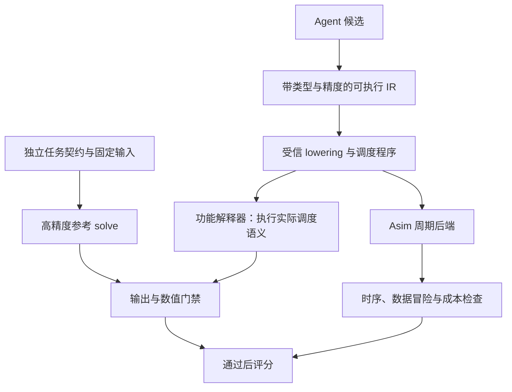

# 验证体系：任务契约、可执行程序与独立参考

2026-11-08 CDL-B/K曲线更新：编码不是求逆/均衡精度的前置。新增真正Sionna CDL-B静态频域输入，21组中6组通过、BRI 1组数值失败、14组象限/溢出拒绝，整体未通过；独立复核7个完整组688,128bit。FP16/FP64的K—误差曲线已归档，显示NS精度平台及固定BRI的收敛问题；不能只加K。216测试通过，仅清理约3.02GB可再下载缓存，旧研究原件保留。见[报告与图](../../experiments/channel_validation/2026-11-08-v1/README.md)及[输入域/精度协议](CHANNEL_DOMAINS.md)。

2026-11-08 Q3b：在成功的原Asim/数值结果之后，新增固定实际指令的I/Q输入响应探针，200测试、375次正例实际重放与独立参考位一致。通过有限复线性/预测/RHS检查才计算Gaussian线性SE代理，不改变原周期或签发总体SE保证。协议/边界见 [RESPONSE_PROBES](../../verification/communication/RESPONSE_PROBES.md)，Q3a真实BER/EVM门禁仍保留。

2026-11-08 Q3a：已有实际重建输出的受限瑞利/QPSK相对BER/原始软符号EVM与留出置信门禁，187测试通过。它不替代独立算法一致性，也不推断尚未支持的SE。历史数据只诊断、校准集不签发通信通过，联合超限使用独立H统计；具体规范和证据见 [COMMUNICATION_VERIFICATION](COMMUNICATION_VERIFICATION.md)。以下日期段保留阶段历史。

状态（2026-11-08）：七个新入口已有真实指令结构/逐操作FP16模型与独立参考验证，保守Core事件检查已验收；正式通信/CDL-B和评分晋级未完成。最新证据见 [七入口报告](MERGE_AND_REMAINING_MAPPING.md)。

本轮新增写算子前的独立算法选K阶段，详见 [精度驱动工作流](QUALITY_DRIVEN_WORKFLOW.md)：校准集冻结门限后选择最小可行K，再独立留出验收。算法筛选不等于算子验收；候选仍在Asim及性能预筛后才重建，并分别比较同算法和高精度MMSE。数值误差不替代正式SE/BER要求。此前方案与证据快照统一从 [论文档案](paper_archive/README.md) 检索。下文早期日期段保留为方案演进。

Q2后续：已加入受监督计划冻结/执行入口，绑定选K证据、任务/参数/精度与固定runtime；171测试、NS/BRI 8场景192batch真实链路和数值NOT_RUN的性能预筛负例通过。详细证据见 [交接验收](../../experiments/quality_handoff/2026-11-08-v2/README.md)。正式通信门禁仍待Q3，不将交接验收升级为通信结论。

v0.4实施更新（2026-10-29）：[通用框架计划](FRAMEWORK_PLAN.md)是本验证标准的当前实施顺序，先用合成低层程序构建受信builder、顺序重放、精度/复数、异步事件和门禁闭环，本阶段不改具体算子。NS仍是后续首个真实算法试点，而非现在必须修改的前置依赖。三路径/G0–G6保持不变，完整IR编译器后置。

统一“数值语义与计时语义”的约束进一步明确：候选只选择合法操作/实现，tile/compute_size/搬运请求数等由受信builder与冻结硬件profile从同一views推导；不得另填低成本字段。高层算法必须展开，SCALAR批量工作与复数实际展开均计费。各算法允许不同指令数，统一的是任务与原语成本规则，不用GEMM数量相似判断正确。

2026-10-28系统审计补充：当前能力与25项缺口见 [验证审计](audits/VERIFICATION_AUTOMATION_AUDIT.md)，文件级首个改造包见 [NS实施计划](audits/NS_SHADOW_EXECUTION_PLAN.md)。这两份是本设计的具体化，不另立验证标准。已执行的Python负例及数学见证见 [诊断制品](../../experiments/audit/2026-10-28/diagnostics.json)，并未证明C++指令正确。

NS先处理比X²更前置的Model/Op输入绑定和shape差异、X0/C未初始化及ADD/SUB身份缺失。LDL已发现行/列缩放冲突，BRI存在初值/预条件系统/轮间状态/输出恢复不一致。当前七实现均为legacy_unverified；不能仅删除末尾平方或补公式日志就晋级。详细源码位置见 [状态卡](operators/INDEX.md)。

## 0. v0.2 实施顺序：先建立算子数值重放

2026-10-28 根据负责人澄清调整：Asim 保持纯周期仿真；首个交付是独立数值影子执行器。完整 IR 编译框架是长期方向，不再作为第一版前置条件。下文第 3 节保留为目标结构，第 4 节的增量迁移作为近期主路线。

操作流程：C++ 算子实际生成 Instruction 时，通过统一受信构建接口同时产生完整语义记录；Asim 消费周期字段，Python 影子执行器消费同一操作对象的数值字段。不能另写一组可以与真实指令脱节的 emit_step 声明。

数值执行器维护虚拟 DRAM、SPAD、ACCUM，以给定输入执行 LOAD/STORE、矩阵乘、逐元素运算、归约和标量操作，输出关键阶段快照与最终结果。初期以高精度确认计算结构，随后加入明确的乘法、累加、存储和量化规则。“近似还原”允许精度模型逐步细化，但操作方向、索引、共轭、常量与数据流必须准确；缺失语义直接报告 UNSUPPORTED。

三条数值路径必须分开：

| 路径 | 输入和执行 | 验证目的 |
|---|---|---|
| 算子影子执行 | 实际生成的操作序列与固定测试输入 | 算子实际计算的结果 |
| 同算法仿真 | 独立 Python 算法，同初值、参数、迭代数与明确精度约定 | 算子是否正确实现选定算法 |
| 高精度任务参考 | 相同 H、y、lambda，独立 solve(A,b) | 算法近似与有限精度是否满足任务质量 |

算子与同算法不符时检查实现；两者相符但与高精度任务参考差距过大时检查收敛、预条件和精度。允许合法浮点重排产生容差内差异，优先比较阶段输出；算法发生融合或等价变换后，不强制内部节点逐一同名。

首个试点是 NS：固定小矩阵与初值，逐步比较 T=A@X、R=2I-T、X=X@R，并验证实际最终输出是 X 还是 X@X。可对算子指令对象注入“漏迭代、加减颠倒、多做平方、错误覆盖”等变异，验证器必须捕获；只改独立算法脚本不能算作算子验证完成。

逻辑顺序的数值重放只验证功能。异步流水的提前读写与覆盖还需结合 Asim 发射／完成事件检查；数值验证通过不能替代调度正确性验证。

## 1. 现有问题的边界

“算法写成算子，再从算子重现算法”只有在重现基于完整、真实执行语义时才可靠。当前 FormulaLogger 是人工或 Agent 额外填写的数学声明，它与实际指令不是同一个事实来源。

本次源码核对得到：

- `src/Common.h` 的 Instruction 主要表达地址、尺寸与时序，尚不足以完整区分复数布局、共轭、元素切片、每一步精度与算术语义。
- `scripts/trace_replay.py` 依赖公式描述补全行为，存在缺失输入分配随机矩阵的路径，且不完整执行 Scalar/Vector。
- `scripts/uobs_scorer.py::validate_trace_formula_consistency` 读取 trace 失败时返回通过；GEMM 数量检查也无法证明数据流等价。
- `orchestrator/pipeline.json` 将数值验证设为可选，部分检查仅确认入口可用或截取输出。
- NS 基线末尾生成 `X @ X`，修正数值脚本返回 `X`。报告中的自一致性通过不能证明两者完成相同求逆任务。

因此，“再加一个审查 Agent”“增加 FormulaLogger 步骤”“提高同原语重放的测试数量”只能辅助，不能消除共同错误与声明失真。

## 2. 首先冻结要计算什么

建议首个任务契约为批量线性 MMSE 均衡：

\[
A=H^H H+\lambda I,\qquad b=H^H y,\qquad A\hat{x}=b.
\]

输入包含 H、接收信号 y、lambda，以及形状、布局和数值格式。输出为软符号估计 x_hat。候选可以显式求逆、分解后求解或迭代求解，但最终交付相同输出；不要求每种算法都生成完整逆矩阵。

约定 H 形状为 `[batch,Nr,Nt]`，y 为 `[batch,Nr,Nrhs]`，输出为 `[batch,Nt,Nrhs]`。`batch` 与同一 H 的右端项数 `Nrhs` 分开。独立参考使用高精度线性求解，例如 `solve(A,b)`；不能按候选算法名选择同算法参考。

噪声、星座归一化、信道归一化和 lambda 必须成套定义。只对 E[xx^H]=I、噪声协方差 sigma²I 的约定使用 lambda=sigma²；若采用其他约定必须给出推导，不混用旧脚本的 `noise_power*Nt`。

契约还需锁定：

- 实／复数语义、转置／共轭转置，AoS/SoA 布局及有效区域。
- 输入、乘法、累加、存储精度；舍入、饱和、溢出、下溢、随机舍入种子。
- 输出形状、别名许可、NaN/Inf 处理、适用域与提前退出规则。
- 输入是否已包含 A、预条件器或初值，以及这些预处理成本如何计入。

两种测量范围分别建榜：① 已提供 A 和 b 的求解内核；② H、y 到 x_hat 的均衡全流程。跨信道复用时用显式相干块长度 R，`T_total(R)=T_setup+R*T_apply`，不能让某算法免费获得预条件器或谱估计。

## 3. 推荐结构：可执行 IR 驱动两个后端

IR 是算子的可执行中间表示，不是第二份自然语言说明。第一版只覆盖当前算子需要的原语，不建设通用编译器。

建议分两层：算法 IR 表达数学运算与数据依赖；调度 IR 表达切片、buffer、搬运、流水单元、同步和发射顺序。算法 IR 可以有 Cholesky 等高层节点，但正式计时前必须降为可执行低层操作；不能把高层原语当成免费或固定价黑盒。

最小字段：`op_id/opcode`、读写 tensor/view、shape/stride/offset、转置与共轭、输入/计算/累加/输出类型、立即数、buffer 空间、依赖与同步事件、有效掩码、边界、迭代参数。每个字段由 schema 和受信构建器检查。

低层原语包括显式 LOAD/STORE、GEMM、ADD/SUB/MUL/DIV/SQRT、归约、填充、切片和同步。SUB 必须有明确减法语义；计时后端若共用 ADD 延迟，也必须保留算术操作身份。

**单一来源不等于天然正确。** 解释器、lowering、周期模型共同构成可信计算基础，需独立原语测试及变异测试。解释器执行低层调度程序；不能只执行高层算法图，再给另一份 C++ 指令计时。

FormulaLogger 后续从 IR 自动派生，用于说明和诊断，不再承担最终真值来源。

## 4. 逐步迁移旧 C++ 算子

短期保留 C++，引入受信 TypedInstructionBuilder，在实际发出指令的入口记录完整操作数、view、精度和常量。数值执行与 Asim 消费同一组对象。对没有语义的旧指令返回 `UNSUPPORTED`，不猜测、不填随机输入。

纯基地址指令无法恢复元素运算，因此并非给旧 trace 增加几个字段就能完成迁移。必须逐个补充元素切片与表达式，或改成统一 IR 生成指令。初期限制优化 Agent 只改候选 IR 和调度参数；可信 builder/lowering 的修改走基础设施版本升级。

可先完成小规模 Cholesky 和 NS 的语义闭环，跑通后再覆盖 LDL、分块和 BRI。旧算子尚未迁移时可继续保留历史周期，但标记 `legacy_unverified`，不与 verified 候选竞争。

每次运行绑定契约、候选源、实际低层程序、输入、编译器及仿真二进制摘要。动态提前退出必须验证多输入的周期分布；静态规模复用周期只允许在能证明指令流不依赖数据时采用。

## 5. 验证门禁

| 层次 | 检查 | 失败处理 |
|---|---|---|
| G0 完整性 | 所有输入／输出、shape、schema、摘要、操作语义齐全 | 缺失或不支持为 INVALID/UNSUPPORTED |
| G1 原语 | 复数、共轭、类型转换、累加、尾块与别名 | 原语或 lowering 失败，停止晋级 |
| G2 算法 | 高精度语义与独立 solve 对比、残差、结构性质 | 算法或输出契约失败 |
| G3 实现 | 精度模型下实际调度程序输出；全部低层指令已覆盖 | 数值或覆盖失败 |
| G4 调度 | 读前写、RAW/WAR/WAW、同步、越界、资源占用 | 时序／内存失败 |
| G5 通信 | 固定样本上的 SER/BER、退化上界、适用域 | 不合格或样本不足，不能评分 |
| G6 复现 | 新工作区重跑同一 commit、输入与工具链 | INFRA_ERROR 或不可复现 |

顺序功能执行不能证明并行调度正确。G4 必须使用发射／完成事件与读写集合检查：例如异步读尚未完成时覆盖源 buffer，不能靠逻辑拓扑序蒙混通过。

对近似算法不要求逐位等于直接法，但需要任务约定的精度与质量界。建议同时记录归一化后向残差：

\[
r=\frac{\|A\hat{x}-b\|_F}{\|A\|_2\|\hat{x}\|_F+\|b\|_F+\epsilon}.
\]

残差、输出误差与 SER 是互补指标；高条件数下小残差不必然代表小前向误差。显式求逆候选另外检查 AX≈I。阈值由小规模校准后冻结，不能为让某候选通过而放宽。

## 6. 试验矩阵与统计

开发集用于反馈，验证集用于晋级，最终留出集用于确认；按信道实例／种子划分，不把同一实例的不同 SNR 分到不同集合。持续暴露留出集会使其失去留出意义。

- 尺寸：保留历史 64×16、128×32、256×64；增加 Nt=15/17/31 等尾块案例；方阵和高负载比作为单独压力组。
- 信道：Rayleigh、现有 CDL-B 实现、受控条件数矩阵。先审核 `scripts/channel/cdl.py`，确认其是否完整实现标准 CDL-B；若只是指数相关近似，报告按实际模型命名。
- 输入：复数非对称样本、接近奇异、强／弱正则化、不同 Nrhs、batch 和幅值范围。
- 固定 H、符号和噪声，成对比较候选与参考。区分逐符号错误和逐信道相关性，用独立信道块 bootstrap 估计 ΔSER 的置信上界。
- 使用预先规定的最小信道数、符号数及误差目标；零观测错误不代表真实 SER=0。样本不足为 INCONCLUSIVE。
- 每个质量分组都需过门禁，不能通过平均值掩盖最差信道或高 SNR 失败。

## 7. 必须能抓住的错误

建立变异测试集：删除一次 GEMM、把 SUB 改 ADD、漏共轭、改错缩放方向、漏一次迭代、输出平方、尾块越界、提前覆盖输入、删除 barrier、跳过初始化、修改迭代初值，以及缺失／损坏 trace。

这些错误应在保持“漂亮 FormulaLogger 文档”的情况下仍被拒绝。对每个已支持变异，要求测试明确失败并归因；不使用一个整体 pass 字段掩盖跳过项。

## 8. 评分与防止指标误导

先硬门禁，再在同一 contract/suite/hardware 组内排序。原始质量指标、周期、搬运、资源与失败原因必须保留。

建议首版仅用周期加速比作为标量搜索反馈：
`score = exp(sum(w_i * log(C_baseline_i / C_candidate_i)))`，其中权重预先冻结；只有所有必测组通过、周期为正且成本口径一致时定义。未通过时 `score=null`，同时记录原因。

多目标结论保留 SER—周期 Pareto 前沿。Cube 利用率、Vector/Scalar 等待、搬运与重叠不进入首版奖励，防止增加无用 GEMM 获得高分。硬件校准完成前明确称为“模型预测周期”。

评分器不信任 Agent 报告的 pass/score；由独立进程读取受信输出。生成工作区与评估工作区隔离，评估器、测试和配置在候选作用域外固定版本。Git worktree 是版本隔离，不是进程权限隔离；后续由独立用户／容器提供只读评估挂载与预算限制。

## 当前执行顺序更新（2026-10-29）

按负责人最新要求：静态完整性检查后先运行Asim；仅运行成功且通过冻结的性能合理性/竞争力筛选，才执行候选数值重建。不具竞争力/异常加速候选可以跳过数值，必须记录NOT_RUN、score=null，不能称正确或数值失败。首批测试信道为瑞利，CDL-B接口后续版本化增加。原语单元测试可独立运行；真实Asim适配尚未接通。

## 2026-10-29七入口重建更新

[七入口重建报告](LEGACY_RECONSTRUCTION_REPORT.md)记录最新实际覆盖：真实Instruction附加views、逐元素初始化/部分写、DMA batch范围、完整输出与事件覆盖检查已落地；七入口正确性未全通过，score=null。独立同算法参考、精度/G4/通信仍缺证，不能用周期正常结束替代验收。专用原件目录`results/reconstruction_campaigns/2026-10-29-legacy7-b96-v2-frozen/`，Git小清单在`experiments/reconstruction_campaigns/`；重跑命令与hash检查见报告，旧数据不移动。

## 2026-10-30统一重建更新

[本轮报告](NS_CORRECTED_VALIDATION.md)为最新覆盖：共同H/Y/λ及计时scope、共享view/初始化/算术核心、新NS三seed×96batch三路径结构通过。79测试通过，旧七入口保留原失败。FP16/G4/通信/G6及评分尚未验收。按[接入指南](ADDING_OPERATOR.md)增加候选与独立参考，不在重建核心添加算法名分支。prepared内核与完整任务不得直接比较；旧generic SUB→raw ADD现显式UNSUPPORTED。

2026-10-30进一步更新：FW3显式FP16/FP32模型与独立参考逐位一致，FW4合成事件hazard检查已实现；真实G4/硬件校准/通信/CDL-B/干净复现仍缺证。106测试通过，详见[论文报告入口与剩余门禁](PAPER_REPORT.md)。阶段报告不冒充最终验收。

2026-10-30稳定入口更新：实际Core读写/DMA事件已完成受限保守模型验收，固定runtime日常命令可用，121测试通过。详情及支持/拒绝边界见[稳定性报告](RUNTIME_STABILITY.md)。旧报告中的缺真实Core事件是当时状态；硬件G4/通信/全部旧算子/最终评分仍未通过，不能由该模型证书升级。
