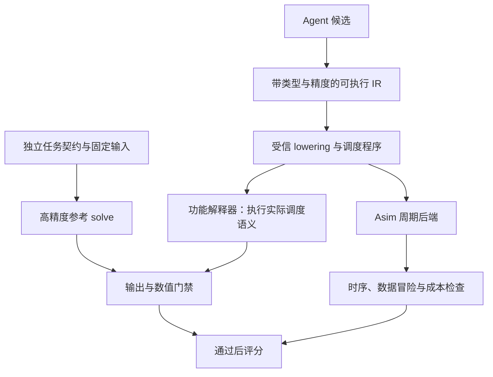

# 验证体系：任务契约、可执行程序与独立参考

状态：设计提案；尚未实现下述 IR、解释器和门禁。

## 1. 现有问题的边界

“算法写成算子，再从算子重现算法”只有在重现基于完整、真实执行语义时才可靠。当前 FormulaLogger 是人工或 Agent 额外填写的数学声明，它与实际指令不是同一个事实来源。

本次源码核对得到：

- `src/Common.h` 的 Instruction 主要表达地址、尺寸与时序，尚不足以完整区分复数布局、共轭、元素切片、每一步精度与算术语义。
- `scripts/trace_replay.py` 依赖公式描述补全行为，存在缺失输入分配随机矩阵的路径，且不完整执行 Scalar/Vector。
- `scripts/uobs_scorer.py::validate_trace_formula_consistency` 读取 trace 失败时返回通过；GEMM 数量检查也无法证明数据流等价。
- `orchestrator/pipeline.json` 将数值验证设为可选，部分检查仅确认入口可用或截取输出。
- NS 基线末尾生成 `X @ X`，修正数值脚本返回 `X`。报告中的自一致性通过不能证明两者完成相同求逆任务。

因此，“再加一个审查 Agent”“增加 FormulaLogger 步骤”“提高同原语重放的测试数量”只能辅助，不能消除共同错误与声明失真。

## 2. 首先冻结要计算什么

建议首个任务契约为批量线性 MMSE 均衡：

\[
A=H^H H+\lambda I,\qquad b=H^H y,\qquad A\hat{x}=b.
\]

输入包含 H、接收信号 y、lambda，以及形状、布局和数值格式。输出为软符号估计 x_hat。候选可以显式求逆、分解后求解或迭代求解，但最终交付相同输出；不要求每种算法都生成完整逆矩阵。

约定 H 形状为 `[batch,Nr,Nt]`，y 为 `[batch,Nr,Nrhs]`，输出为 `[batch,Nt,Nrhs]`。`batch` 与同一 H 的右端项数 `Nrhs` 分开。独立参考使用高精度线性求解，例如 `solve(A,b)`；不能按候选算法名选择同算法参考。

噪声、星座归一化、信道归一化和 lambda 必须成套定义。只对 E[xx^H]=I、噪声协方差 sigma²I 的约定使用 lambda=sigma²；若采用其他约定必须给出推导，不混用旧脚本的 `noise_power*Nt`。

契约还需锁定：

- 实／复数语义、转置／共轭转置，AoS/SoA 布局及有效区域。
- 输入、乘法、累加、存储精度；舍入、饱和、溢出、下溢、随机舍入种子。
- 输出形状、别名许可、NaN/Inf 处理、适用域与提前退出规则。
- 输入是否已包含 A、预条件器或初值，以及这些预处理成本如何计入。

两种测量范围分别建榜：① 已提供 A 和 b 的求解内核；② H、y 到 x_hat 的均衡全流程。跨信道复用时用显式相干块长度 R，`T_total(R)=T_setup+R*T_apply`，不能让某算法免费获得预条件器或谱估计。

## 3. 推荐结构：可执行 IR 驱动两个后端

IR 是算子的可执行中间表示，不是第二份自然语言说明。第一版只覆盖当前算子需要的原语，不建设通用编译器。

建议分两层：算法 IR 表达数学运算与数据依赖；调度 IR 表达切片、buffer、搬运、流水单元、同步和发射顺序。算法 IR 可以有 Cholesky 等高层节点，但正式计时前必须降为可执行低层操作；不能把高层原语当成免费或固定价黑盒。

最小字段：`op_id/opcode`、读写 tensor/view、shape/stride/offset、转置与共轭、输入/计算/累加/输出类型、立即数、buffer 空间、依赖与同步事件、有效掩码、边界、迭代参数。每个字段由 schema 和受信构建器检查。

低层原语包括显式 LOAD/STORE、GEMM、ADD/SUB/MUL/DIV/SQRT、归约、填充、切片和同步。SUB 必须有明确减法语义；计时后端若共用 ADD 延迟，也必须保留算术操作身份。

**单一来源不等于天然正确。** 解释器、lowering、周期模型共同构成可信计算基础，需独立原语测试及变异测试。解释器执行低层调度程序；不能只执行高层算法图，再给另一份 C++ 指令计时。

FormulaLogger 后续从 IR 自动派生，用于说明和诊断，不再承担最终真值来源。

## 4. 逐步迁移旧 C++ 算子

短期保留 C++，引入受信 TypedInstructionBuilder，在实际发出指令的入口记录完整操作数、view、精度和常量。数值执行与 Asim 消费同一组对象。对没有语义的旧指令返回 `UNSUPPORTED`，不猜测、不填随机输入。

纯基地址指令无法恢复元素运算，因此并非给旧 trace 增加几个字段就能完成迁移。必须逐个补充元素切片与表达式，或改成统一 IR 生成指令。初期限制优化 Agent 只改候选 IR 和调度参数；可信 builder/lowering 的修改走基础设施版本升级。

可先完成小规模 Cholesky 和 NS 的语义闭环，跑通后再覆盖 LDL、分块和 BRI。旧算子尚未迁移时可继续保留历史周期，但标记 `legacy_unverified`，不与 verified 候选竞争。

每次运行绑定契约、候选源、实际低层程序、输入、编译器及仿真二进制摘要。动态提前退出必须验证多输入的周期分布；静态规模复用周期只允许在能证明指令流不依赖数据时采用。

## 5. 验证门禁

| 层次 | 检查 | 失败处理 |
|---|---|---|
| G0 完整性 | 所有输入／输出、shape、schema、摘要、操作语义齐全 | 缺失或不支持为 INVALID/UNSUPPORTED |
| G1 原语 | 复数、共轭、类型转换、累加、尾块与别名 | 原语或 lowering 失败，停止晋级 |
| G2 算法 | 高精度语义与独立 solve 对比、残差、结构性质 | 算法或输出契约失败 |
| G3 实现 | 精度模型下实际调度程序输出；全部低层指令已覆盖 | 数值或覆盖失败 |
| G4 调度 | 读前写、RAW/WAR/WAW、同步、越界、资源占用 | 时序／内存失败 |
| G5 通信 | 固定样本上的 SER/BER、退化上界、适用域 | 不合格或样本不足，不能评分 |
| G6 复现 | 新工作区重跑同一 commit、输入与工具链 | INFRA_ERROR 或不可复现 |

顺序功能执行不能证明并行调度正确。G4 必须使用发射／完成事件与读写集合检查：例如异步读尚未完成时覆盖源 buffer，不能靠逻辑拓扑序蒙混通过。

对近似算法不要求逐位等于直接法，但需要任务约定的精度与质量界。建议同时记录归一化后向残差：

\[
r=\frac{\|A\hat{x}-b\|_F}{\|A\|_2\|\hat{x}\|_F+\|b\|_F+\epsilon}.
\]

残差、输出误差与 SER 是互补指标；高条件数下小残差不必然代表小前向误差。显式求逆候选另外检查 AX≈I。阈值由小规模校准后冻结，不能为让某候选通过而放宽。

## 6. 试验矩阵与统计

开发集用于反馈，验证集用于晋级，最终留出集用于确认；按信道实例／种子划分，不把同一实例的不同 SNR 分到不同集合。持续暴露留出集会使其失去留出意义。

- 尺寸：保留历史 64×16、128×32、256×64；增加 Nt=15/17/31 等尾块案例；方阵和高负载比作为单独压力组。
- 信道：Rayleigh、现有 CDL-B 实现、受控条件数矩阵。先审核 `scripts/channel/cdl.py`，确认其是否完整实现标准 CDL-B；若只是指数相关近似，报告按实际模型命名。
- 输入：复数非对称样本、接近奇异、强／弱正则化、不同 Nrhs、batch 和幅值范围。
- 固定 H、符号和噪声，成对比较候选与参考。区分逐符号错误和逐信道相关性，用独立信道块 bootstrap 估计 ΔSER 的置信上界。
- 使用预先规定的最小信道数、符号数及误差目标；零观测错误不代表真实 SER=0。样本不足为 INCONCLUSIVE。
- 每个质量分组都需过门禁，不能通过平均值掩盖最差信道或高 SNR 失败。

## 7. 必须能抓住的错误

建立变异测试集：删除一次 GEMM、把 SUB 改 ADD、漏共轭、改错缩放方向、漏一次迭代、输出平方、尾块越界、提前覆盖输入、删除 barrier、跳过初始化、修改迭代初值，以及缺失／损坏 trace。

这些错误应在保持“漂亮 FormulaLogger 文档”的情况下仍被拒绝。对每个已支持变异，要求测试明确失败并归因；不使用一个整体 pass 字段掩盖跳过项。

## 8. 评分与防止指标误导

先硬门禁，再在同一 contract/suite/hardware 组内排序。原始质量指标、周期、搬运、资源与失败原因必须保留。

建议首版仅用周期加速比作为标量搜索反馈：
`score = exp(sum(w_i * log(C_baseline_i / C_candidate_i)))`，其中权重预先冻结；只有所有必测组通过、周期为正且成本口径一致时定义。未通过时 `score=null`，同时记录原因。

多目标结论保留 SER—周期 Pareto 前沿。Cube 利用率、Vector/Scalar 等待、搬运与重叠不进入首版奖励，防止增加无用 GEMM 获得高分。硬件校准完成前明确称为“模型预测周期”。

评分器不信任 Agent 报告的 pass/score；由独立进程读取受信输出。生成工作区与评估工作区隔离，评估器、测试和配置在候选作用域外固定版本。Git worktree 是版本隔离，不是进程权限隔离；后续由独立用户／容器提供只读评估挂载与预算限制。
