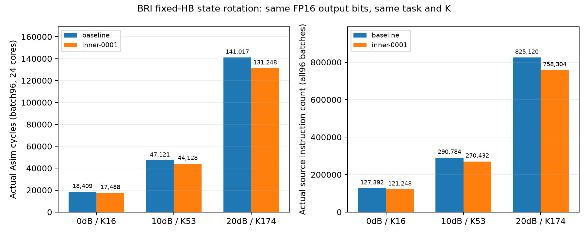

# BRI内循环0001：状态缓冲区轮换

2026-11-10（Asia/Hong_Kong）。状态INNER_LOOP_SOFTWARE_CANDIDATE_CHECKED；score=null，尚未M3冷构建复现/正式晋级。默认主工作区和运行时仍是基线。

## 如何管理优化

采用同一算子族/同一Model、mode、operator_id，独立candidate_id+Git分支/worktree/build保存实现；不为每轮复制新算子类，不覆盖基线，也不在共享Model累积逐轮if。新算法或任务契约变化才新入口。BRI内部的指令/布局/流水与参数优化都记内循环，但子类型分开，参数/精度变化不能声称纯指令等价。

本轮family=bri，algorithm=bri_fixed_hb_fp16_v1；operator_id=bri_stable_hb_fp16_v1。初始baseline=bri-hb-base-v1，candidate=bri-hb-inner-0001，parent为该基线。基线是已通过限定CDL软件验收的固定HB直接MMSE实现，不是全部历史BRI的统一性能基线。

- [基线快照](../baseline-v1.json)：原三档周期、参数、输入/配置identity、原质量和证据SHA，不覆盖。
- [候选冻结清单](candidate.json)：源码commit88acdaed、binary、允许修改范围、全部参数/K、评估器/参考/配置/工具链SHA、性能和质量门限。
- [追加台账](../ledger.jsonl)：hash链记录baseline、candidate、每档实际run、通信/配对/控制等事实。缺证/失败保留，不把自报分数当通过。
- [可重建对比视图](../comparison.csv)：从台账导出，含尺寸/batch/profile/K/λ/初始化/谱界规则/周期/误差/通信状态/版本；[本轮详细表](cases.csv)另给误差中位数/P95/最大值和指令数。

完整规则：[OPTIMIZATION_TRACKING](../../../../DOCS/research/OPTIMIZATION_TRACKING.md)。后续轮次保留初始baseline_id，并冻结本轮性能预筛用的对照；parent_candidate_id记录从哪轮改起，不用可移动分支名代替commit。

## 假设与实现

[设计](../../../../DOCS/operators/bri_inner_0001.md)先于代码。每轮carry计算完后，不再执行previous←x与x←value两个32×8 FP16复制；生成指令时把逻辑(previous,x,value)的物理地址角色从(A,B,C)改为(B,C,A)。原所有数值算术、初值、预条件、谱界/αβ、补偿、完整分配和输出恢复保持不变。

删除每迭代两条MUL(1)及其两条barrier，未增添免费算术/归约；K16/53/174分别覆盖三种最终槽位。完整实际指令数每batch从591+46K变为591+42K。独立审计穷举63,488个有限FP16位型，乘1对±0和次正规也逐位不变；实际事件检查与输出重建进一步验证地址读写。

候选代码在`/home/nanajiang/asim-worktrees/bri-inner-0001/`，分支`codex/bri-inner-0001`，冻结commit `88acdaed5e2f565f76a1a9f91f789ff07a440c67`。[candidate.patch](candidate.patch)可独立审阅。主工程源码未换成候选，仍保留原基线。构建为独立-j1增量构建：143共享C++源码字节一致、383对象复制校验，Asim本体重新编译/链接，第三方缓存复用，不冒称冷构建。[回执](build_cache.json)、[构建日志](build.log)保留。

## 实际结果

共同H/Y/λ→直接MMSE输出，Nr64/Nt16/RHS8/batch96、24核、Cube16³；FP16持久张量/状态/系数，既有FP32临时算术、固定k序GEMM、RNE/保留次正规、无融合。不是纯FP16 MAC或混合精度新指令。

| λ / SNR | 冻结K | 基线周期 | 候选周期 | 周期减少 | 新CDL最大MMSE误差 |
|---|---:|---:|---:|---:|---:|
| 1 / 0dB | 16 | 18,409 | 17,488 | 5.003% | 0.840812% |
| .1 / 10dB | 53 | 47,121 | 44,128 | 6.352% | 0.971608% |
| .01 / 20dB | 174 | 141,017 | 131,248 | 6.928% | 0.817267% |



[PDF图](cycle_instruction_comparison.pdf)。

周期为真实Asim实测，非指令数推算。三档与基线的comparison_identity严格相同：seed57001、输入、硬件配置、精度、完整计时边界相同。基线原周期由其封存binary测得；新评估器的兼容证据与原版本区别明确保留，不能把旧周期改写成此次重跑。全部288个瑞利batch与基线/独立算法FP16输出位一致，任务误差不变。

通过真实Asim/事件/性能预筛后才生成新H61001/61002及载荷61101/61102，各96个静态CDL-B信道。固定K不重选，因为本轮是严格算术等价的指令优化；未使用H590选参。新192个独立H复用三SNR，共576batch，全部实际指令重建与独立同算法逐位一致，FP64 MMSE误差≤2%。未编码QPSK相对BER≤.01/SER≤.02/raw EVM≤.01，逐H超限及joint均0/192，置信上界3.1644%<5%。详细参数/门限见[parameters.json](parameters.json)，参考系数范围见[coefficient_ranges.csv](coefficient_ranges.csv)。

再将原基线的封存真实指令在完全相同新H/载荷上重放576batch，全部输出与候选逐位一致，所以该批BER/SER/EVM相同；见[paired_baseline.json](paired_baseline.json)。这没有重新运行基线Asim，也没有增加独立H样本数。旧H590的BER不与新H610混作配对提升。candidate相对MMSE的少量bit波动不代表算法质量优于基线。

[流水总表](pipeline_summary.csv)和[24核分表](core_pipeline_summary.csv)同时包含baseline/candidate三档（42流水行、1008逐核行）；全量逐指令CSV、trace、读写事件在原始结果目录。Cube运算结构不变，利用率用于诊断，不因无效矩阵运算奖励。

## 控制、独立审计与时间

[静态审计](static_audit.md)、[动态审计](dynamic_audit.md)和机器结果明确范围：全部保存输出/任务参考重算，流式抽batch0检查每轮角色/最终地址、current与previous状态、±0；新CDL全部任务及QPSK小数据独立复核。主评估器负责全部事件及576batch程序重放，独立审计不冒称又重放了全部大制品。

[controls.json](controls.json)：三档各错最终槽/缺语义的六个离线变异均拒绝；真实性能拒绝+重复测试得到SKIPPED_NOT_COMPETITIVE、numerics NOT_RUN，无numerics_started/references/outputs，且instructions/dispatch/trace/rw四文件与原候选完全相同；错误批准SHA预检拒绝且台账不变。离线变异不是故障二进制实验。台账链/重复ID/证据变化2项单元测试通过；既有250项框架代码未修改，当前91文件默认runtime哈希保持有效。

Asim模板全阶段（含事件/参考/重建）560.67s；新H生成15.96s；新CDL参考/重建时间在各frame记录；基线配对重放215.80s。各run有独立阶段墙钟，Agent纯思考时间null。构建墙钟没有独立可靠测量，不用mtime或残差估计。

## 归档与下一步

原件固定`results/optimization/bri/inner-0001/`，[run_manifest.json](run_manifest.json)记录路径/大小/SHA。台账查看/导出：

```bash
.venv/bin/python scripts/optimization_ledger.py \
 --ledger experiments/optimization/bri/ledger.jsonl \
 --csv experiments/optimization/bri/comparison.csv
```

原candidate manifest SHA为`0c4cc1f8b4fd5402370d0f2257a6eebfb719b1a2718f6a8c4699fa0443b4119e`，冻结根提交2cc4e653。`campaign.py`按asim→dataset→replay执行，`paired_baseline.py`配对、`controls.py`门禁；现有目录/事件ID拒绝覆盖。再次实验须新run/candidate计划与独立输出目录，不直接重跑覆盖当前封存。评估器在主工程，候选仅一处C++文件，候选不能顺带改参考/阈值/配置。

下一轮可研究保留数据依赖的同步/流水重排或复用，仍以当前候选为parent、初始基线为长期对照；若改谱界/K/预条件，则归参数内循环并另做新校准/冻结/留出。冷构建跨环境复现和正式性能晋级M3尚未完成，score=null；默认基线不自动切换。硬件时序由负责人上板另验。
