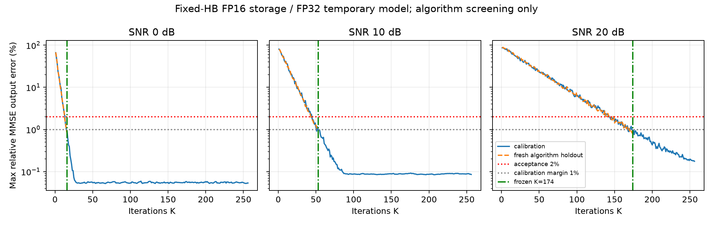

# 固定系数 HB：FP16 隐式 MMSE 的独立筛选（2026-11-09-v1）

本页记录算法级数值筛选，实际 C++ 指令与 CDL-B 重建验收另见 [原生接入](../../fixed_hb_native/2026-11-09-v1/README.md)。旧 β-only 候选的失败不覆盖、不升级。

## 设计与冻结

[设计](../../../DOCS/research/F16_STABLE_HB_DESIGN.md)先于代码提交2256ef6b；实现f02b8d61，契约0f25fa90，选K冻结bfe16983。实际FP16系数整轮固定，α使用15/16安全因子，β不再单独乘0.9；保守谱界仅用ADD/MUL/DIV/SQRT及真实归约。候选内部不调用eig/solve。独立FP64谱仅用于审计。解析误差界见 [独立审计](math_review.md)。固定伴随矩阵的线性稳定证明不替代FP16有限误差检查。

Nr64/Nt16/RHS8、batch96。任务为直接MMSE均衡输出；FP16存储、FP32临时算术/固定k序GEMM，保留次正规数/RNE，不增加Asim指令，不是全FP16 MAC或实机精度证明。e_j范围[2^-8,8]，FP16顺序能量和[8,32]；域外UNSUPPORTED，不裁剪或参考补值。

## 结果

校准H58001（96），K1…256。固定一个算法方案，接受门限2%；选最早使K至256全后缀≤1%的K，不能称之为最小2%K。冻结后生成全新H58002/58003，共192个独立H，复用三SNR；不能算576个独立信道。

| SNR / λ | 首次2%校准K | 首次1%校准K | 冻结后缀K | 新留出最大MMSE误差 |
|---|---:|---:|---:|---:|
| 0dB / 1 | 14 | 16 | 16 | 0.818353% |
| 10dB / .1 | 45 | 51 | 53 | 0.994268% |
| 20dB / .01 | 142 | 168 | 174 | 0.823068% |

全部新留出输出及初始化/界/系数与独立实现逐FP16位一致；无失败样本。全部实际舍入系数和谱包络满足审计条件。旧失败H56002/b95仅作回归，新K174误差0.526091%，不用于选K或留出统计。详见 [summary](summary.json)、[回归](old_failure_regression.json)、[冻结选择](selection.json)。

[PDF](iterations_error.pdf)及[曲线数据](iterations_error.csv)可用于论文；实线校准全K，虚线新留出只计算至冻结K，后者不用于重选。高K并非必然更好，本文方法还要求校准后缀稳定。

本阶段QPSK错误数只作算法诊断，不代替原生重建通信门禁。纯Agent思考时间不可测，为null；留出阶段墙钟约76.66s，独立参考分档约5.99/14.90/44.22s，逐阶段原值见原始result。

## 制品与复现

原始数据固定 `results/fixed_hb/2026-11-09-v1/`，包含calibration_inputs、holdout_inputs、逐K曲线、FP16输出和旧失败回归。契约SHA `f142978a788aead6b2092838aba4a355850e3de42a797ab21a3e138199a4ce24`，选择SHA `4c29b1052d8dfb2871b23ecb81ce0bfcf42bbec3b60cd1daf5709b25a3300b2f`。运行入口 `python -m verification.studies.stable_hb_campaign --help`，新复现必须使用新的输出目录；不要覆盖冻结样本和结果。[报告生成器](tools/report.py)只读取结果，单元测试245项通过见[日志](unit-tests.log)。新原生入口另行冻结全新H59001/59002，不复用本研究的留出作为原生泛化证明。
